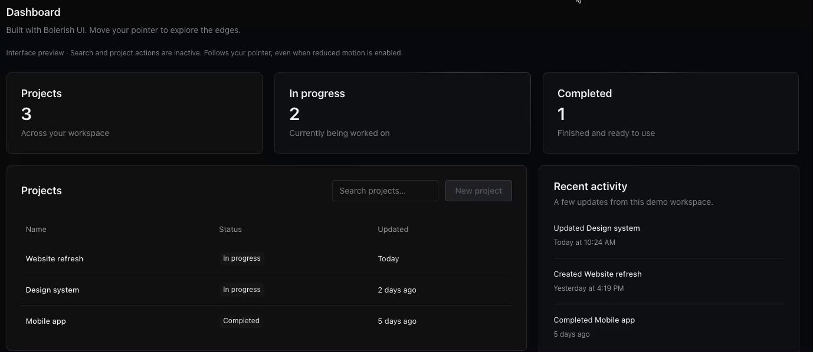

# Edge

A little more alive. Connect your React components to one shared directional light.



## Quick start

Requires React 18 or 19.

```sh
npm install @bolerish/edge
```

```tsx
import { Edge } from '@bolerish/edge';

export function Area() {
  return (
    <Edge.Provider>
      <Edge.Surface as="article">Your card</Edge.Surface>
      <Edge.Surface as="button" type="button">
        Save
      </Edge.Surface>
    </Edge.Provider>
  );
}
```

React prepares the default styles automatically when a surface connects. For SSR, render `<Edge.Styles />` once before application styles; pass your request nonce with `<Edge.Styles nonce={nonce} />` when CSP requires it. Keep the same nonce during hydration. Existing `@bolerish/edge/style.css` imports remain supported. Only marked surfaces respond; your colors, layout and interactions stay yours.

## Direction and range

```tsx
<Edge.Provider direction="toward" range={480}>
  <Edge.Surface>Your card</Edge.Surface>
</Edge.Provider>
```

`direction` defaults to `toward`, facing highlights toward the pointer. Use `away`
for the opposite direction. Recessed surfaces draw the highlight one decorative
edge thickness inward while preserving the selected direction. `range` is the fade distance outside each surface in CSS pixels, defaults to
480, and must be positive and finite. These options affect pointer-driven lighting;
fixed lighting uses `staticDirection` instead. With `range={40}`, the effect fades to
zero when the pointer is 40 CSS pixels outside a surface. It does not limit the
bright area inside a surface to a 40-pixel circle around the pointer.

The direction values were renamed: replace `gather` with `toward` and `spread`
with `away`, and replace `radius` with `range` when upgrading from 0.3.0.

## Documentation

See the [guides and API reference](https://edge.bolerish.com/docs/) for styles, motion, integration and rendering.

## Contributing

See [CONTRIBUTING.md](CONTRIBUTING.md) for setup and checks.

## License

[MIT](LICENSE).
